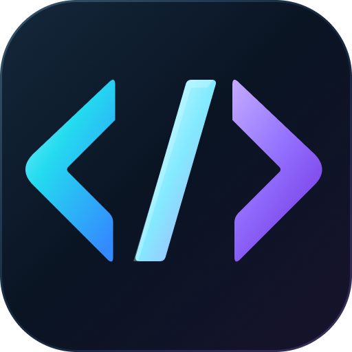

<div align="center">
  
  <h1>@kovari/code</h1>
  <p><strong>Production-oriented auditable AI agent runtime for the Kovari IDE, desktop app, application and web surfaces.</strong></p>
  <p>    </p>
</div>


## Overview
`@kovari/code` builds coding-agent capabilities on the published `kovari` runtime. Shared configuration, events, retries, concurrency, policies, logging, workspaces and testing utilities are imported from `kovari@0.1.11`; this package adds command execution, transactional edits, repository search, Git operations, diagnostics and a composed coding SDK.

## Install
```bash
npm install @kovari/code
```
The normal dependency installs `kovari@^0.1.11` automatically.

## Quick start
```ts
import createKovariCode from "@kovari/code";
import { FakeModelProvider } from "@kovari/code/testing";
const code = createKovariCode({ model: new FakeModelProvider("Ready"), config: { workspaceRoot: process.cwd() } });
console.log(await code.search.text("TODO", { extensions: [".ts"], limit: 25 }));
```

## Kovari integration
- `core`, `config`, `events`, `runtime`, `security` and `logging` re-export Kovari contracts.
- Workspace behaviour extends the secure Kovari workspace boundary.
- Commands use Kovari policies and events.
- Search uses Kovari concurrency controls.
- The SDK composes the Kovari agent runtime with coding capabilities.

## Quality gates
```bash
npm install
npm ci
npm run typecheck
npm run build
npm test
npm run validate
npm run check
npm run pack:verify
npm run pack:dry
npm run publish:dry
npm run release:check
```

## Security
Paths stay inside the configured workspace root. Process execution uses explicit argument arrays with no shell. Policies authorise effects, cancellation limits work, and edit transactions write temporary files before replacement.

## Licence
MIT.
